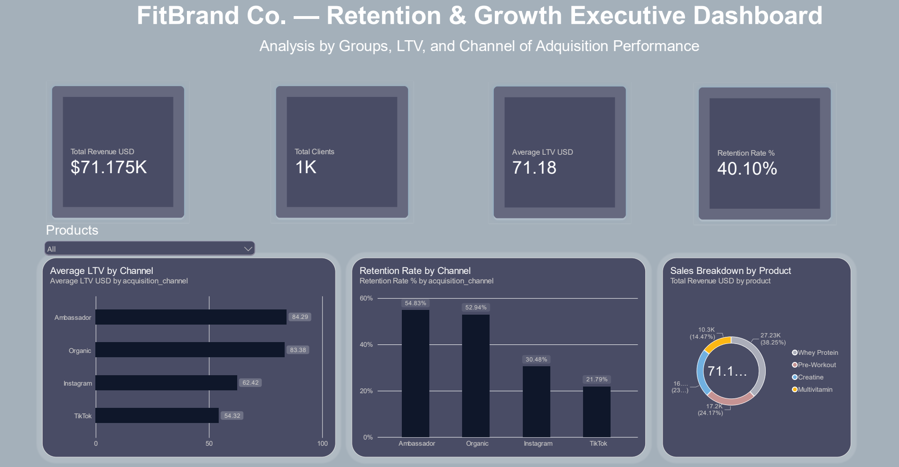

# FitBrand Co. — D2C Retention & Growth Analytics

> **Executive Summary:** A business-first data analytics case study solving early-cohort churn and unit economic dilution in a D2C sports nutrition brand. Analyzed 1,807 transactions across 1,000 unique customers using **Python, SQLite, Power BI, and React (Lovable)**.

---

## Live Dashboard & Quick Links

| Asset | Resource Link | Description |
| :--- | :--- | :--- |
| **Interactive Web App** | [**View Live Lovable Dashboard**](https://fitbrandretention.lovable.app) | Full interactive web application with dynamic filters and cohort drill-downs. |
| **Power BI Dashboard** | [`powerbi/FitBrand_Dashboard.pbix`](./powerbi/FitBrand_Dashboard.pbix) | Production-ready Power BI report with custom DAX measures. |
| **Executive Report** | [`docs/FitBrand_Executive_Report.pdf`](./docs/FitBrand_Executive_Report.pdf) | Complete PDF strategic report and financial roadmap. |



---

## Table of Contents

- [Business Problem](#business-problem)
- [Key Results & Unit Economics by Channel](#key-results--unit-economics-by-channel)
- [Key Insight: Blended LTV vs. Retained LTV](#key-insight-blended-ltv-vs-retained-ltv)
- [Tech Stack & Repository Architecture](#tech-stack--repository-architecture)
- [Strategic Action Plan & Managerial Decisions](#strategic-action-plan--managerial-decisions)
- [How to Run Locally](#how-to-run-locally)

---

## Business Problem

FitBrand Co. scaled top-line revenue across multiple digital marketing channels (**$71,175 USD total revenue** across **1,807 transactions** from **1,000 unique customers**). However, net profit margin expansion decoupled from sales growth.

### The Core Bottleneck
- **59.90% overall cohort churn** after Order #1 (Global retention rate sits at **40.10%**).
- **Misallocated marketing spend:** Capital was being assigned based solely on initial customer acquisition volume without accounting for long-term retention or channel-specific CAC.
- **The Core Question:** *Why does Customer Lifetime Value (LTV) vary so drastically by acquisition channel, and how can we reallocate existing capital to maximize net margin without needing additional ad budget?*

---

## Key Results & Unit Economics by Channel

A channel-by-channel financial diagnosis shows that top-of-funnel volume from paid social (TikTok) delivers low net value, while brand affiliate channels (Ambassador) and organic search drive high profitability.

### Channel Unit Economics Matrix

| Channel | Retention Rate (%) | Average LTV | Gross Margin (65%) | Estimated CAC | Net Profit / Client |
| :--- | :---: | :---: | :---: | :---: | :---: |
| **Organic** | **52.94%** | $83.38 | $54.20 | $0.00 | **$54.20** |
| **Ambassador** | **54.83%** | **$84.29** | $54.79 | $8.00 | **$46.79** |
| **Instagram** | **30.48%** | $62.42 | $40.57 | $12.00 | **$28.57** |
| **TikTok** | **21.79%** | $54.32 | $35.31 | $15.00 | **$20.31** |

### Critical Takeaways
1. **Ambassador is +130% more efficient than TikTok:** An Ambassador-acquired customer yields **$46.79 USD in net profit** vs. **$20.31 USD** for TikTok due to lower acquisition costs ($8 vs. $15 CAC) and significantly higher retention (54.83% vs. 21.79%).
2. **Organic Search is the Margin Champion:** Yielding **$54.20 USD net profit** per customer, organic retention proves that high trust at acquisition translates directly into recurring profit.
3. **TikTok Unit Margin Fragility:** With a **$35.31 USD gross margin** against a **$15.00 USD CAC**, TikTok leaves minimal room for error. Any spike in CAC makes the channel net-unprofitable.

---

## Key Insight: Blended LTV vs. Retained LTV

Looking only at **Blended LTV** leads to a wrong conclusion: that TikTok traffic is inherently "low quality." 

**Blended LTV (Order #1 Included):**
Ambassador: $84.29 USD  │  TikTok: $54.32 USD  ──► Gap: $29.97 USD (~55% higher)

However, isolating **retained customers only** (`purchase_number > 1`) reveals a completely different picture:

**Retained-Only LTV (Repeat Buyers):**
Ambassador: ~$123.91 USD  │  TikTok: ~$111.08 USD  ──► Gap narrows to ~$12.83 USD (~11%)

### The Diagnostic Finding
TikTok's weakness is **not customer quality long-term**; it is **first-purchase drop-off**. TikTok buyers suffer from high impulse-buying behavior and lack an immediate post-purchase engagement onboarding. When a TikTok customer is successfully converted to Order #2, their long-term value almost matches that of an Ambassador buyer. 

The strategic goal is therefore not to abandon TikTok, but to **fix the first 30-day retention loop**.

---

## Tech Stack & Repository Architecture

- **Data Processing & Synthetic Generation:** Python (Pandas, Faker)
- **Database & Advanced Analytics:** SQLite (SQL Window Functions: `LAG()`, `JULIANDAY`)
- **Business Intelligence & Visualization:** Power BI (DAX Modeling) & React (Lovable Web App)

```text
fitbrand-d2c-retention-analytics/
├── data/
│   ├── raw/fitbrand_transactions.csv          # Transactional dataset (1,807 rows)
│   └── database/fitbrand.db                   # SQLite relational database
├── notebooks/
│   └── 01_etl_and_eda_fitbrand.ipynb          # Python ETL pipeline & EDA
├── sql/
│   ├── 01_retention_and_ltv_by_channel.sql    # LTV & retention aggregation queries
│   └── 02_repurchase_velocity_window_lag.sql  # SQL LAG() repurchase velocity analysis
├── powerbi/
│   ├── FitBrand_Dashboard.pbix                # Power BI data model & dashboards
│   └── screenshots/dashboard_preview.png     # Dashboard preview image
├── docs/
│   └── FitBrand_Executive_Report.pdf          # PDF Executive Strategy Report
├── requirements.txt                           # Python dependencies
└── README.md                                  # Repository documentation
```

### Core Analytical SQL Logic (Repurchase Lag Analysis)
Using `LAG()` window functions, we calculated the empirical purchase delay across core product categories:

```SQL
WITH ordered_purchases AS (
    SELECT
        client_id,
        product,
        purchase_date,
        LAG(purchase_date) OVER (
            PARTITION BY client_id, product
            ORDER BY purchase_date
        ) AS previous_purchase_date
    FROM transactions
)
SELECT
    product,
    ROUND(AVG(JULIANDAY(purchase_date) - JULIANDAY(previous_purchase_date)), 0) AS avg_days_to_repurchase
FROM ordered_purchases
WHERE previous_purchase_date IS NOT NULL
GROUP BY product;
```
---

## Strategic Action Plan & Managerial Decisions

To expand net profit without increasing ad spend, we designed a Zero-Incremental-Budget Plan:

### 1. Capital Reallocation (30% Spend Shift)
- Reallocate 30% of TikTok top-of-funnel paid spend into the Ambassador commission program (increasing top creator commissions from 10% to 15%).
- On TikTok, restructure initial offers away from single SKUs to High-AOV Entry Bundles ($80–$90 USD) to absorb the $15 CAC on the very first order.

### 2. Pre-Depletion Automated Triggers (N - 3 Days)
Empirical analysis identified a consistent ~5-day repurchase lag beyond the nominal product depletion cycle. Automating retargeting prompts 3 days prior to stockout captures replenishment intent before customers switch to competitors:
- **Whey Protein** (30-day supply | 35-day actual repurchase) ──► Trigger Email/SMS at Day 27
- **Pre-Workout** (45-day supply | 51-day actual repurchase) ──► Trigger Email/SMS at Day 42
- **Creatine** (60-day supply | 65-day actual repurchase) ──► Trigger Email/SMS at Day 57
- **Multivitamin** (90-day supply | 95-day actual repurchase) ──► Trigger Email/SMS at Day 87

### 3. Channel-Specific Post-Purchase Onboarding
Implement a dedicated 30-day educational sequence (workout routines, usage guides, recipes) specifically for paid social buyers (TikTok/Instagram) to bridge the engagement gap and curb impulse churn.

### 4. Margin-Protected Subscribe & Save
Offer dynamic checkout cross-sells paired with a 10% recurring discount on second deliveries. Expanding initial Order Value (AOV) protects gross margins above the 65% baseline while securing subscription lock-in.

---

## How to Run Locally

### Prerequisites
- Python 3.9+
- Power BI Desktop (for `.pbix` inspection)

### 1. Clone the Repository
```bash
git clone https://github.com/tomas-analizes/fitbrand-d2c-retention-analytics.git
cd fitbrand-d2c-retention-analytics
```
### 2. Set Up Environment & Install Dependencies
```bash
python -m venv venv
source venv/bin/activate  # On Windows use: venv\Scripts\activate
pip install -r requirements.txt
```
### 3. Execute Data Pipeline
```bash
jupyter notebook notebooks/01_etl_and_eda_fitbrand.ipynb
```
### 4. Query Database directly via SQLite
```bash
sqlite3 data/database/fitbrand.db < sql/01_retention_and_ltv_by_channel.sql
```
---

*Case Study developed by Data Analytics & Growth Operations Specialist.*
